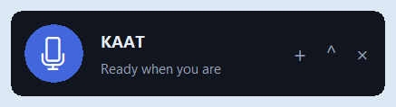

# Whisper (formerly KAAT)

**Speak naturally. Get things done.**

Whisper is an intelligent voice and desktop companion for Windows. It provides natural voice & text control for launching applications, web searches, YouTube media playback, volume & window management, camera recording, and automated video editing (silence & pause trimming, filler removal, subtitle burning). Gnani Prisma v3.0 powers speech recognition; a deterministic controller and optional local MCP adapter execute commands with native speed and reliability.

Double-click `run_whisper.bat` or run `.\.venv\Scripts\python.exe app.py` to start Whisper.

See the [emergency repair report](docs/EMERGENCY_REPAIR.md) for the latest executed checks, Windows evidence and remaining gaps. Earlier [camera delivery evidence](docs/DELIVERY_CHECK.md) records a real laptop-microphone command and saved, decoded camera recordings. Those earlier checks alone do not prove newly added spoken application commands. Recording targets the tested English Windows Camera UI; continuous streaming, precise word alignment and universal third-party application control remain unsupported.



## Run on Windows

Use Python **3.10+**, Windows 10/11, and FFmpeg with `ffprobe`, H.264/AAC encoding and the `subtitles` filter. The current local microphone check uses standalone Python **3.13.7** and FFmpeg 9.0.2. Earlier checks used Store Python 3.13.14, whose package microphone access was denied. No Docker, Node, model training or LLM account is required.

```powershell
# From this folder; downloads a local FFmpeg build if absent.
powershell -ExecutionPolicy Bypass -File .\setup.ps1 -DownloadFFmpeg
# setup creates .env only if it does not already exist.
notepad .env
# Set GNANI_API_KEY privately; file editing remains usable without it.
powershell -ExecutionPolicy Bypass -File .\run.ps1
# Or double-click run_kaat.bat; it checks critical dependencies before opening KAAT.
.\run_kaat.bat
```

The FFmpeg download is the Windows build linked by [FFmpeg's download page](https://ffmpeg.org/download.html), hosted by [Gyan](https://www.gyan.dev/ffmpeg/builds/). If FFmpeg is already on PATH, omit `-DownloadFFmpeg`. Source releases exclude the downloaded binary; preserve that build's license notices if distributing it yourself. NTFS/local storage is recommended: safe atomic publication needs hard-link support.

Manual setup:

```powershell
py -3 -m venv .venv
.\.venv\Scripts\python.exe -m pip install -r requirements-dev.txt
.\.venv\Scripts\python.exe -c "from engine import _ffmpeg; _ffmpeg()"
.\.venv\Scripts\python.exe app.py
```

Check the environment without opening the microphone or camera:

```powershell
.\.venv\Scripts\python.exe doctor.py
# Optional: send this explicitly selected human speech clip to the real provider.
.\.venv\Scripts\python.exe doctor.py --audio 'C:\path\short_hinglish.wav'
# Check the intended export directory too; this does not render a video.
.\.venv\Scripts\python.exe doctor.py --output-dir 'C:\path\output'
```

The checker prints **PASS**, **FAIL**, or **NOT TESTED** for each named check. Device inventory is separate from capture, TLS connectivity is separate from authentication, and a returned transcript is separate from recognition accuracy. It never prints the API key. `run_kaat.bat --check` runs only startup checks; a missing Gnani key leaves typed commands available. Setup failures keep the launcher open with an actionable error.

Optional filler-word proposals use a separate local speech model. The normal `setup.ps1` installs the core app; install this extra explicitly:

```powershell
.\.venv\Scripts\python.exe -m pip install -r requirements-speech.txt
```

Select a video and click **Fillers**, or enter `filler words hata de`. The first use downloads the local model. Gnani remains the primary command/transcription provider; local Whisper supplies its own approximate per-word timing for these proposals, not Gnani word alignment. Suggestions require listening, review and explicit approval. The public human Hinglish check returned **zero filler suggestions**: analysis ran, but this does not demonstrate successful filler removal or prove the source has no fillers. A user-supplied recording and human review remain pending.

A separate real interview-filler fixture produced **11 review proposals** with the local `base` model. This verifies positive candidate generation only: exact boundaries were not independently annotated and removal accuracy remains unvalidated. See [fixture attribution and limits](delivery/VERIFICATION.md).

## Use the floating companion

1. KAAT opens as a small borderless widget at the bottom-right, above other apps. Drag the **KAAT** name/status area to move it. **+** opens a video, **⌃** expands the controls, **⌄** collapses them, and **×** quits. Expansion opens upward and keeps the microphone in place; dragging is clamped to the screen's usable area.
2. Click the microphone and wait for green **Listening** before speaking. A popup shows actual progress, recognized words and the result; errors offer relevant actions. Local WebRTC speech detection starts the end timer after sustained voice, followed by one second of quiet. The default maximum is six seconds. In **Preferences**, change **Listen up to (seconds)** and **Save**, or set `KAAT_CAPTURE_SECONDS` in `.env` to a finite value from 0.5 to 25 seconds and restart; a saved preference takes precedence. Silence-based early completion waits at least two seconds unless the configured maximum is shorter. Press the microphone again or **Escape** to cancel. Cancelling native capture stops its worker; cancellation during an already-sent network request suppresses the returned action while that bounded request finishes. Cancellation cannot undo a tool that has already started. Empty/quiet/no-speech input never becomes an invented command. **Try again** and **Microphone…** are available in the notification. Expansion is optional for typed commands and editing controls.
3. Inspect **Cuts** and **Activity**. Silence detection proposes cuts with 180 ms padding at a conservative −40 dB amplitude threshold. The default minimum gap is **2 seconds**.
4. Select a cut and **Approve**, or explicitly **Approve all** after review. Suggested and restored decisions do not affect the export. **Undo** restores the previous decision state; **Clear edits** is also undoable.
5. **Export MP4** writes a new video and a JSON edit-decision list, including approved and unapproved operations, source SHA256, and original/planned edited duration. Existing output files are never overwritten.
6. Optionally choose **Transcribe**, inspect its coarse audio-chunk captions, find retake suggestions, and enable **Add subtitles**. When an approved cut partially removes a nonempty caption cue, export transcribes the retained audio for captions, making additional actual Prisma requests. This prevents deleted speech from surviving in captions; it does not supply word alignment. Whole-kept/whole-deleted cues can be remapped without new recognition. Supplied segment timestamps are caller data, not automatically verified alignment.
7. In **Preferences**, explicitly **Save pause setting**, or say `Kaat, always remove pauses longer than 3 seconds`. Relaunching preserves approved preferences. **Reset pause setting** deletes the saved value. A one-time `remove pauses over 3 seconds` changes only the current session.

Recognition and tool errors appear in the widget and Activity tab. Expand the drawer to type requests or review edits; spoken commands work while it is collapsed. Full-video transcript text is editing content and is never fed back into the command parser. PTT activation separates instructions from ordinary recorded speech; ambient parsing also requires a leading wake word. Unknown, negated and deferred instructions do not execute tools.

Restoring one decision leaves any other approved overlapping cut active; a warning explains the remaining removal. Commands accept supported signed/decimal time units, reject invalid thresholds and ambiguous independent compounds, and preserve explicit choices such as `export without subtitles`.

Useful instructions:

| Spoken or typed instruction | Actual behavior |
|---|---|
| `Kaat, Chrome khol de` / `Open Google Chrome` | Resolve Chrome's installed path, launch and verify a visible Chrome window |
| `Open Notepad` / `Notepad chala de` | Launch installed Notepad and verify its window |
| `Open Calculator` / `Calculator kholo` | Launch Windows Calculator and verify its window |
| `Open File Explorer` | Open Explorer and verify a folder window |
| `Open my Downloads folder` / `Mera Downloads folder khol` | Resolve Windows' actual Downloads folder and check Explorer's opened path |
| `Google Photos khol de` / `Mujhe YouTube khol ke dikha` | Open the approved website and check the browser's exposed address |
| `List installed apps` / `Show active application` | Read registered Windows applications / the actual foreground window |
| `Close all those stuff which you have opened recently.` | Request normal closure of newly created windows tracked by this KAAT version; preserve unrelated windows |
| `Remember my settings` / `Show my preferences` | Persist the current pause threshold and subtitle setting / retrieve local preferences |
| `help` | Show supported actions |
| `Kaat, open camera` / `camera kholo` | Open Windows Camera locally; no video selection required |
| `start recording` / `shoot a quick reel` | Start real Windows Camera recording and verify its UI state |
| `pause recording` / `resume recording` | Pause/resume the actual camera capture |
| `stop recording` | Stop, verify the saved MP4, and select it for editing when the session is empty |
| `Kaat, pauses hata de` | Propose long-pause cuts |
| `filler words hata de` / **Fillers** | With the optional speech package installed, propose possible fillers using local model-estimated timing; never auto-approve |
| `remove pauses over 3 seconds` | Propose cuts using a session-only threshold |
| `approve all cuts` | Approve displayed suggestions |
| `Kaat, undo kar` | Undo the last decision change |
| `Kaat, ye wala rehne de` | Undo the last decision change; no live pointer targeting |
| `Kaat, pichla part hata de` | Explain missing live boundary; enter explicit source seconds |
| `Kaat, keep the last take` | Suggest earlier duplicates from an existing timed transcript |
| `Kaat, always remove pauses over 3 seconds` | Explicitly persist the preference |
| `Kaat, export` | Ask for a fresh output path in the desktop overlay |

**Closing KAAT-opened windows:** the exact request `Close all those stuff which you have opened recently.` routes to `system.close_recent`. KAAT records only new windows it created, with a unique ownership marker and a persistent local SQLite journal. It rechecks the marker and process identity before closing. Pre-existing or reused windows, tabs opened inside them, windows opened by other applications, and windows from before this tracking update stay open. Restarting KAAT retains the journal; it does not make older untracked windows eligible.

For supported default browsers, website commands open a dedicated new window so that only that window can later be closed. Unsupported-browser fallback tabs remain untracked. KAAT sends a normal close request and never force-kills the application or answers its save/discard prompts. A window that remains open is reported as unverified; active or paused Camera recording is protected. Applications can request user confirmation when handling [Windows WM_CLOSE](https://learn.microsoft.com/en-us/windows/win32/winmsg/wm-close). An ambiguous `close all` asks for clarification locally rather than letting the optional planner guess.

## Optional reasoning proposals

Common commands work without an LLM. To opt into proposals for otherwise unsupported activated requests, privately configure `KAAT_PLANNER_URL` with the full chat-completions endpoint and `KAAT_PLANNER_MODEL`; set `KAAT_PLANNER_KEY` only if that provider needs a bearer key. Remote endpoints require HTTPS; HTTP is accepted only on localhost. An existing local compatible server can therefore be used without a paid account. KAAT does not install or start one.

This planner returns **needs_review**, **needs_clarification**, or a real failure. A proposal always has `verified:false` and executes **no tools**. Review the listed steps and issue individual supported commands yourself; KAAT has no automatic multi-step executor. Date-based file search such as “kal wali video” is not implemented: select the exact recording or supply its quoted path. The provider receives your activated command and limited selected-video context (path, pause/subtitle settings and explicitly supplied paths), not your media, microphone audio or history. The reasoning-provider network integration remains **NOT TESTED** unless a real configured-provider run is separately recorded.

## Local MCP server

```powershell
.\.venv\Scripts\python.exe mcp_server.py
```

The stdio server exposes `video.inspect`, `video.detect_pauses`, `video.detect_retakes`, `video.propose_cut`, `video.approve_cut`, `video.restore_cut`, `video.undo`, `video.export`, transcript/EDL tools, memory tools and allowlisted Windows adapters. Desktop and MCP invoke the **same AgentController**. They have separate in-memory video sessions; each server process has one selected source. Inspecting another source clears its current decisions.

Example local MCP host configuration (replace the absolute paths):

```json
{
  "mcpServers": {
    "kaat": {
      "command": "C:\\path\\kaat-mvp\\.venv\\Scripts\\python.exe",
      "args": ["C:\\path\\kaat-mvp\\mcp_server.py"]
    }
  }
}
```

Call `video.inspect({"source":"C:\\path\\video.mp4"})`, then `video.detect_pauses`, review `session.state`, approve specific IDs, and `video.export({"output":"C:\\path\\cleaned.mp4"})`. Camera recording tools require `approved:true` from a trusted local client carrying the user's explicit instruction. The desktop also applies its remembered local device consent. Device listing uses real DirectShow enumeration. Application, website and folder tools use the same Windows implementation as typed/voice commands; no arbitrary shell command is accepted. This optional stdio adapter runs on the same computer; the desktop app does not require it.

`system.close_recent({"approved":true})` uses the same locally recorded window ownership as desktop cleanup. A trusted local MCP client must supply the user's explicit close request; omitting approval fails. It does not close every window belonging to the named applications.

Application aliases resolve to trusted installed executables or registered Windows application IDs. `Photos` deliberately means the Google Photos website; it does not choose the Windows Photos application. Website launch verification checks the browser address exposed by Windows UI Automation; folder verification checks Explorer's actual location. A launch accepted by Windows without enough resulting window/URL/path evidence returns **unverified**, not a fabricated success. A visible window proves launch, not that every feature inside that application works. Google Photos may require the user's own Google sign-in.

## Tests and reproducible demo

```powershell
.\.venv\Scripts\python.exe -m pytest -q -rs
.\.venv\Scripts\python.exe scripts\demo.py --output demo_output
.\.venv\Scripts\python.exe scripts\check_desktop.py
```

Tests exercise English/Hindi/Hinglish parsing, activation and negation, preference persistence, stable decisions/undo, overlapping intervals, actual generated-media silence detection and exports, decoded-frame/PCM content, timestamp offsets, odd dimensions, subtitles and real MCP stdio calls. Install FFmpeg before running media/MCP checks. The basic desktop smoke check above opens a real window but drives the shared implementation directly; the stronger practical QA used actual Windows mouse/keyboard input and native dialogs. The reproducible tone demo is explicitly **synthetic**, while separate real public human-audio/provider checks and actual Chromium playback are documented in [QA_REPORT.md](docs/QA_REPORT.md). Pick a new output folder when rerunning a demo; existing outputs are protected.

The Gnani integration test runs only with `GNANI_API_KEY` and `KAAT_TEST_AUDIO` pointing to an explicitly selected short human Hinglish WAV. It performs a real API request. Provider-boundary unit tests remain labelled separately; they do not establish live success. See [Gnani integration](docs/GNANI.md) and the [live demo script](docs/DEMO.md).

An **earlier** configured run passed 160 tests and 17 native scenarios. Those checks included recorded audio and typed instructions; they did not exercise successful microphone capture. The later real microphone attempt exposed the denied-runtime failure. Keep the historical result separate from the [earlier root-cause investigation](docs/ROOT_CAUSE_REVIEW.md) and [latest acceptance evidence](docs/EMERGENCY_REPAIR.md); a test total alone does not prove that the complete voice workflow passes.

To reproduce the human-audio checks, prepare public media first. This step downloads two licensed speech clips and generates a video with a controlled pause; it makes no Prisma request:

```powershell
.\.venv\Scripts\python.exe scripts\check_prisma_real.py --prepare-only --output test_output\public_demo
$env:KAAT_TEST_AUDIO = (Get-ChildItem test_output\public_demo -Filter *.wav | Select-Object -First 1).FullName
.\.venv\Scripts\python.exe -m pytest -q -rs
.\.venv\Scripts\python.exe scripts\check_native_workflow.py --source test_output\public_demo\human_hinglish_with_pause.mp4 --output test_output\native_check
.\.venv\Scripts\python.exe scripts\check_mcp_real.py --source test_output\public_demo\human_hinglish_with_pause.mp4 --output test_output\mcp_check
```

The configured suite, native transcript check and MCP workflow make actual Prisma requests using your private key. The native check moves the mouse and types into KAAT and its real file dialogs; leave the desktop available while it runs. Use fresh output directories to preserve previous evidence. To measure public-sample transcription errors in all three output styles, run `scripts\check_prisma_real.py --output test_output\speech_check` without `--prepare-only`.

## Microphone troubleshooting

At startup KAAT checks local device names/IDs, Windows camera and microphone consent settings, and whether Windows Camera is registered. Discovery runs separately from command execution and does not open the camera or microphone. Right-click the widget and choose **Camera & microphone** to inspect the information, or **Open camera** to launch Camera. `Open camera`, `camera kholo` and `कैमरा खोलो` also work as activated commands without a selected video.

On first launch, a local **Allow / Not now** popup asks for KAAT device access. **Allow** is remembered in `desktop_permissions.json` beside the local KAAT database; a waiting microphone/camera request then continues. **Not now** leaves access unapproved. This desktop consent is stored only on the client, with no permission server. Windows retains control of its own device permissions: a known Windows denial links to **Open Windows settings**. Voice transcription sends explicitly captured audio directly to Gnani, as disclosed in the popup.

Wait for **Listening** rather than speaking during Preparing. The level display measures actual input; a persistent 0.0–0.1% level with **No microphone activity detected** is not a successful voice command. Check the selected Windows input, mute and input-volume controls, then try again. KAAT does not send that quiet buffer to Prisma or execute an inferred instruction.

If the error names denied access for the Python runtime, inspect **Windows Settings → Privacy & security → Microphone**, including the individual Python app. The global and desktop-app switches can be allowed while Store Python is specifically denied. KAAT reports that known denial before entering the audio driver; it does not change Windows privacy settings.

Alternatively, close KAAT and use an installed standalone Python from python.org. Check that the launcher path is not WindowsApps before upgrading the existing environment:

```powershell
py -3 -c "import sys; print(sys.executable)"
py -3 -m venv --upgrade .venv
.\.venv\Scripts\python.exe -m pip install -r requirements-dev.txt
powershell -ExecutionPolicy Bypass -File .\run.ps1
```

If `py -3` still selects Store Python, choose the full standalone interpreter path listed by `py -0p`. Driver opening/capture runs in a short-lived process with deadlines so a blocked native audio call cannot leave the widget waiting forever. A capture success alone still does not prove that a spoken command was heard and executed.

## Privacy and persistence

Preferences, latest session metadata and up to 500 recent tool outcomes live in `%USERPROFILE%\.kaat\kaat.sqlite3`, or `KAAT_DATA_DIR`. New application/server processes start a fresh editing session; the last metadata snapshot is retained for inspection, not automatically reapplied. Transcript text stays in RAM until close, except requested caption exports. Temporary microphone/extracted audio is deleted after processing. Prisma requests send audio to Gnani; video rendering stays local. KAAT never silently approves edits or stores complete microphone conversations. Delete the local data directory to erase all KAAT memory when the app/server is closed.

## Documentation and release

- [Floating overlay and native Windows verification](docs/OVERLAY.md)
- [Latest emergency repair, executed checks and remaining gaps](docs/EMERGENCY_REPAIR.md)
- [Submission pack and desktop walkthrough](delivery/README.md)
- [Earlier live voice and native recording evidence](docs/DELIVERY_CHECK.md)
- [Local camera, permission popup and speech-latency fixes](docs/CAMERA_CLIENT.md)
- [Architecture and data flow](docs/ARCHITECTURE.md)
- [Exact Gnani integration and API limits](docs/GNANI.md)
- [Seven upstream repositories and license/reuse decisions](docs/REUSE.md)
- [Runtime attribution](docs/THIRD_PARTY.md)
- [Demo and live Hinglish script](docs/DEMO.md)
- [Internship submission description](docs/SUBMISSION.md)
- [Test evidence and remaining limitations](docs/VALIDATION.md)
- [Practical native/browser/provider QA and fixes](docs/QA_REPORT.md)
- [Earlier microphone and editing root-cause review](docs/ROOT_CAUSE_REVIEW.md)

Create a source release with `python scripts/package_release.py`. The archive excludes credentials, downloaded tools, generated recordings, local databases and the virtual environment. This folder is prepared for GitHub; it is not currently a Git checkout and nothing has been pushed.


A separate real filler-fixture controller check produced 11 proposals and exported a 12.00-second source to 5.42 seconds with full audio/video decode and the source hash unchanged. Approval was issued by test automation, not human review. This verifies the proposal-to-export path, not independent word-boundary accuracy or editorial safety. Evidence: `test_output/filler_real/actual_controller_export.json`. The primary Hinglish demo still returned zero filler proposals.
