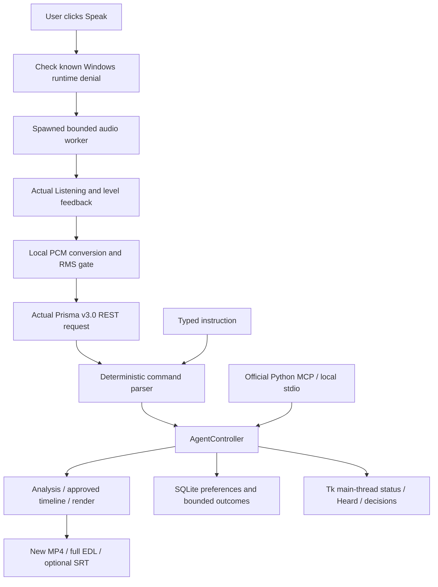

# KAAT architecture

Current follow-up: [DELIVERY_CHECK.md](DELIVERY_CHECK.md) records the successful live microphone command and actual Windows Camera recording controls, superseding older pending/unsupported notes.

KAAT extends the existing Python/Tkinter/FFmpeg starter. Desktop and local stdio MCP use the same `AgentController`; there is no mandatory LLM, container or separate cloud service. See [ROOT_CAUSE_REVIEW.md](ROOT_CAUSE_REVIEW.md) for actual microphone failures and acceptance boundaries.

## Boundaries and modules

The overlay starts as a small borderless topmost tool window. Its editing workspace is a hidden drawer, opening above the compact microphone bar. Native monitor work areas bound dragging and expansion; the microphone stays anchored while the drawer opens. This is a presentation layer over the existing controller, not a separate editor or web application. See [OVERLAY.md](OVERLAY.md) for actual Windows interaction evidence.

`app.py` runs a Tk overlay and a background task executor. Phase/results travel through a queue to the main thread. `voice.py` owns audio acquisition and official Gnani calls; `commands.py` handles explicit deterministic instructions; `controller.py` owns selection, approval, undo and tools; `engine.py` performs actual FFprobe/FFmpeg operations. `memory.py` stores approved preferences, latest session metadata and bounded task outcomes. `mcp_server.py` exposes the same tools through official FastMCP. `system_tools.py` contains fixed Windows adapters, not arbitrary shell execution.

Desktop and MCP have independent in-memory selected-video sessions. SQLite preferences can be shared through an explicit data directory. Opening another source clears that process's decisions; restarting begins a fresh edit session while retaining approved preferences.

## Microphone execution

A valid key or device inventory alone does not establish microphone permission. The actual failure involved a Store Python package-specific denial while global/non-packaged permission was allowed. The known denial is checked before entering the driver. The local environment now uses standalone Python 3.13.7; the application does not silently change Windows privacy settings.

Driver setup/capture occurs in a short-lived multiprocessing spawn worker. The parent consumes progress/audio messages while the child runs, applies opening/capture deadlines and terminates blocked workers. This avoids an uncancellable native audio call trapping a background thread indefinitely. Windows capture selects the available WASAPI input/native sample rate, then locally converts to 16 kHz mono PCM. Preparing, actual Listening with countdown/level, Processing and Transcribing are separate from the actual Heard/error result. Quiet audio stops before the provider request.

No always-on microphone loop or continuous streaming is implemented. The latest actual capture opened/completed but was quiet; the user confirmed they were not speaking. Human microphone-command acceptance remains pending.

The [local camera follow-up](CAMERA_CLIENT.md) adds passive startup device/consent discovery in a separate thread, the Windows Camera launch adapter and immediate modeless feedback. No remote permission component is involved. Command capture can now finish after one second of quiet following sustained activity, while retaining the six-second maximum. Gnani REST transcription still occurs after capture; it is not streaming recognition.

## Reversible media timeline

Every cut has a stable ID, source start/end, reason and explicit status. Only approved intervals are unioned and subtracted; overlaps count once. Undo snapshots change only for real decision changes. Restoring one cut does not cancel another approved overlap, which produces a warning.

Video frames are selected/remapped against the original approved timeline; audio is trimmed/concatenated independently. This prevents the former per-range video concat from repeatedly padding audio to rounded video-frame durations. The actual 20-cut drift reproduction changed from 7.61 seconds to its 7.2-second plan. Independent decoded frames/PCM check content and timing; source hashes protect the original.

Captions use actual transcript/caller timestamps without manufacturing word alignment. If an approved cut partially removes a nonempty source cue, its text cannot safely be split from timestamps alone: export transcribes only retained audio and creates captions on the edited timeline. Fully kept/deleted cues can be remapped without new recognition. These are still coarse captions when Prisma returns chunk text.

Exports complete all artifacts in temporary storage, refuse existing/source aliases, verify the source and publish fresh outputs using hard links. NTFS/local filesystems with hard-link support are required. Extra tracks and arbitrary metadata are not guaranteed to survive re-encoding.

## Persistence and truthful outcomes

SQLite connections close per operation. Tool execution is serialized by the controller lock, with visible structured errors and warnings when history storage fails. Raw microphone conversations are not archived. Temporary audio is deleted and in-memory transcripts clear on exit unless explicitly exported.

Automated unit/provider-boundary checks, recorded-human API checks, native file-dialog checks and actual microphone acceptance are separate evidence categories. Historical passing totals do not turn a missing-key test or quiet capture into successful speech recognition. Recording controls, arbitrary third-party apps and streaming remain unsupported.
