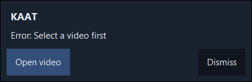

# Local camera and permission feedback

Historical follow-up: [DELIVERY_CHECK.md](DELIVERY_CHECK.md) contains the newer successful live voice check and implemented native recording controls. It supersedes pending/unsupported statements in this earlier report.

The reported camera command failed because `commands.py` had no open-camera intent and the application allowlist contained only Notepad and Explorer. The compact interface also hid every error behind “Needs attention · expand”. Neither was a server permission failure.

`open camera`, `camera kholo`, `camera open kar` and `कैमरा खोलो` now route to the fixed local Windows Camera URI handler. Negated, conversational and combined requests remain rejected. Opening Camera does not require a video or Gnani key. Recording automation remains unsupported; launching the app never claims to start recording.

Startup passively reads local device names/IDs, known Windows camera/microphone consent settings and Camera app registration. A separate discovery thread keeps it out of the command executor. No capture, HTTP request or consent write occurs during discovery. Right-click **Camera & microphone** to inspect it. A known denial produces a nonmodal popup with **Open Windows settings**; other errors show immediately with their relevant action. Preparation, listening and recognized words also appear without expanding the editing drawer. Windows remains responsible for consent; unknown settings and driver errors are not treated as granted access. See Microsoft's [camera privacy guidance](https://learn.microsoft.com/en-us/windows/apps/develop/camera/camera-privacy-setting).

The former six-second capture always waited to its limit. The local RMS activity gate now finishes after one second of quiet following at least 100 ms of activity. It retains initial silence, pauses shorter than one second and isolated-click rejection. Sustained background noise can keep it open to the six-second cap. This is amplitude endpoint detection, not a speech classifier. REST recognition still waits for the captured command and depends on Gnani/network time; no partial transcript or instant recognition is fabricated.

## Evidence and limits

`scripts/check_camera_client.py --interactive --output test_output/camera_client` uses real Windows pointer/keyboard events. It starts with no Gnani key, waits for real DirectShow inventory, types an actual camera command, verifies the Camera process has a visible native window, and exercises visible errors, actionable popups, collapse and dismissal. Camera is a UWP app here: its outer frame belongs to ApplicationFrameHost, so verification checks the visible child belonging to the actual WindowsCamera PID. An initial test incorrectly expected a nonzero process MainWindowHandle; its failed report remains in `test_output/camera_client_run1` rather than being relabelled a pass.

The latest native run passed **26 checks**, discovered devices in **0.647 seconds**, and returned the camera command result in **0.196 seconds**. It left the actual Camera app open. The popup check verifies work-area placement and captures only the popup, without saving a camera preview image. Reports live in ignored `test_output/camera_client_run*`. These checks prove application launching and feedback, not usable camera frames or a human-spoken microphone command. The native UI accessibility tree showed Camera controls including Change camera and Take video; no recording was activated.

The configured full suite passed **223 tests in 33.44 seconds**, with an explicitly selected public human WAV and a real Gnani integration request. Units separately cover denied/missing Camera, conservative parser behavior and PCM endpoint detection. In deterministic PCM tests, a 0.6-second active command ends capture at 1.6 seconds; a 0.6-second internal pause is preserved. These are unit stream inputs and are not presented as physical microphone performance.
