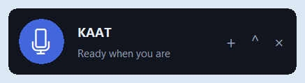

# Floating companion interface

KAAT now starts in a **330 × 76 logical-pixel** compact mode. It has no native title bar, stays above ordinary desktop applications and is excluded from the full application taskbar. The main controls are the microphone, one short status line, open file (+), expand/collapse and close. Cut lists, transcripts, preferences, exports and diagnostic activity stay inside an optional drawer.

Drag by the KAAT name or status. The window stays inside the monitor's work area, including its taskbar boundary. The drawer opens upward and left while preserving the bottom-right anchor and microphone position whenever screen space allows. Opening controls never changes a video or activates recording. Microphone capture still requires pressing its button; quiet audio, permission errors and unsupported commands are not presented as successes.

The compact status shows real preparation/listening/processing stages. Errors and voice feedback appear immediately in a small modeless popup; the drawer is optional. Permission failures offer **Open Windows settings** on this computer. Escape collapses the drawer; Ctrl+O opens a file. The expanded command field accepts normal keyboard focus. Drag and expansion remain available during work. See [the camera and feedback follow-up](CAMERA_CLIENT.md).

## Verification

`tests/test_overlay.py` runs three real Tk layout/callback checks. `scripts/check_overlay.py --interactive` sends actual Windows mouse and keyboard input, reads native window styles, and checks hit-testing while another process owns foreground focus. It verified **25 native checks**, including TOPMOST/TOOLWINDOW styles, no title/resize frame, actual edge-clamped dragging, anchored expansion, keyboard focus and collapse. The separate foreground application was a disposable native test window; this is OS overlay evidence, not a claim of application-specific automation.

No microphone or provider request ran in these overlay checks. A separate desktop edit smoke check selected generated media, detected/approved/undid cuts and exported it with its original hash unchanged; it exercises the shared implementation directly, rather than claiming another native interaction test.

Local screenshots and the native report are in ignored `test_output/overlay/`. The compact preview above is captured from that actual window. The editing engine, microphone permission guard, bounded capture and source-preservation policy are unchanged by this interface change.
